# SOC Home Lab — Wazuh + Sysmon Detection Engineering

A hands-on Security Operations Center home lab built to practice endpoint monitoring, threat detection, MITRE ATT&CK mapping, alert investigation, and false-positive tuning using Wazuh, Sysmon, Windows Security auditing, and PowerShell telemetry.

The project simulates common attacker behaviors in a controlled environment and validates how those activities are collected, detected, classified, and investigated by a SIEM.

---

## Overview

This lab was designed to reproduce a small SOC environment composed of a monitored Windows endpoint and a dedicated Linux-based Wazuh server.

The project covers:

- Windows endpoint telemetry collection
- Sysmon monitoring
- Windows Security auditing
- PowerShell Script Block Logging
- Wazuh detection rules
- MITRE ATT&CK mapping
- Detection validation
- False-positive analysis
- SIEM rule tuning
- Evidence collection and investigation

A total of **12 detection scenarios** and **2 false-positive tuning cases** were validated.

## Documentation

- [Lab Setup](docs/lab-setup.md)
- [Detection Catalog](docs/detections.md)
- [MITRE ATT&CK Coverage](docs/mitre-attack.md)
- [Detection Tuning](docs/tuning.md)

---

## Architecture



The editable Mermaid source is available at:

[`architecture/soc-home-lab-architecture.mmd`](architecture/soc-home-lab-architecture.mmd)

### Endpoint

- Windows 11 Pro
- Wazuh Agent 4.14.9
- Sysmon 15.22
- Windows Security Auditing
- PowerShell Script Block Logging

### SOC Server

- Debian 13
- Docker
- Wazuh Manager 4.14.9
- Wazuh Indexer
- Wazuh Dashboard

---

## Detection Scenarios

| ID | Detection | Telemetry | Wazuh Rule | Level | MITRE ATT&CK |
|---|---|---|---:|---:|---|
| SOC-001 | Windows Brute Force | Security Event 4625 | 60204 | 10 | T1110 |
| SOC-002 | Security Log Clearing | Security Event 1102 | 63103 | 5 | T1070 |
| SOC-003 | Local User Creation | Security Event 4720 | 60109 | 8 | T1098 |
| SOC-004 | Local User Deletion | Security Event 4726 | 60111 | 8 | T1098 / T1531 |
| SOC-005 | Local Account Creation via Command Line | Sysmon Event 1 | 92040 | 12 | T1136.001 |
| SOC-006 | PowerShell Process Discovery | PowerShell Event 4104 | 91815 | 4 | T1057 |
| SOC-007 | PowerShell Base64 Decoding | PowerShell Event 4104 | 91809 | 10 | T1140 |
| SOC-008 | Suspicious Script Creation in Temp | Sysmon Event 11 | 92213 | 15 | T1105 |
| SOC-009 | PowerShell File Compression | Sysmon Event 11 | 92212 | 14 | T1105 |
| SOC-010 | Registry Run Key Persistence | Sysmon Event 13 | 92302 | 6 | T1547.001 |
| SOC-011 | PowerShell Connection to WinRM Port | Sysmon Event 3 | 92110 | 4 | T1021.006 |
| SOC-012 | Scheduled Task Creation | Security Event 4698 | 60228 | 4 | T1053 |

---

## SOC-001 — Windows Brute Force

Multiple failed Windows authentication attempts were generated and correlated by Wazuh.

The base authentication failure event was Windows Security Event ID `4625`. Wazuh correlated repeated failures and generated rule `60204`.

**Detection**

```text
Rule: 60204
Level: 10
MITRE: T1110 — Brute Force
```

Evidence:

[`evidence/SOC-001`](evidence/SOC-001/)

---

## SOC-002 — Security Log Clearing

The Windows Security audit log was cleared in the test endpoint.

Windows generated Event ID `1102`, which was detected by Wazuh rule `63103`.

**Detection**

```text
Event ID: 1102
Rule: 63103
Level: 5
```

A copy of the Security event log was exported before clearing it for forensic preservation.

Evidence:

[`evidence/SOC-002`](evidence/SOC-002/)

---

## SOC-003 — Local User Creation

A local Windows account was created.

Windows generated Event ID `4720`, which was detected by Wazuh.

**Detection**

```text
Event ID: 4720
Rule: 60109
Level: 8
MITRE: T1098
```

Evidence:

[`evidence/SOC-003`](evidence/SOC-003/)

---

## SOC-004 — Local User Deletion

A previously created local account was removed.

Windows generated Event ID `4726`.

**Detection**

```text
Event ID: 4726
Rule: 60111
Level: 8
MITRE: T1098 / T1531
```

Evidence:

[`evidence/SOC-004`](evidence/SOC-004/)

---

## SOC-005 — Local Account Creation via Sysmon

A local account creation command was executed and monitored through Sysmon Process Creation telemetry.

The resulting command execution was detected by Wazuh rule `92040`.

**Detection**

```text
Sysmon Event ID: 1
Rule: 92040
Level: 12
MITRE: T1136.001 — Local Account
```

Evidence:

[`evidence/SOC-005`](evidence/SOC-005/)

---

## SOC-006 — PowerShell Process Discovery

PowerShell Script Block Logging captured execution of:

```powershell
Get-Process | Select-Object -First 5
```

Wazuh identified the activity as process discovery.

**Detection**

```text
PowerShell Event ID: 4104
Rule: 91815
Level: 4
MITRE: T1057 — Process Discovery
```

Evidence:

[`evidence/SOC-006`](evidence/SOC-006/)

---

## SOC-007 — PowerShell Base64 Decoding

A benign Base64 string containing `SOC-LAB` was decoded with PowerShell using `FromBase64String`.

The objective was to validate detection of PowerShell decoding behavior without executing malicious payloads.

**Detection**

```text
PowerShell Event ID: 4104
Rule: 91809
Level: 10
MITRE: T1140 — Deobfuscate/Decode Files or Information
```

Evidence:

[`evidence/SOC-007`](evidence/SOC-007/)

---

## SOC-008 — Suspicious Script Creation in Temp

PowerShell created a `.ps1` file inside the user's `AppData\Local\Temp` directory.

Sysmon captured the file creation event.

**Detection**

```text
Sysmon Event ID: 11
Rule: 92213
Level: 15
MITRE: T1105
```

Evidence:

[`evidence/SOC-008`](evidence/SOC-008/)

---

## SOC-009 — PowerShell File Compression

PowerShell was used to create a ZIP archive.

Sysmon Event ID `11` captured creation of the archive and Wazuh identified the behavior.

**Detection**

```text
Sysmon Event ID: 11
Rule: 92212
Level: 14
MITRE: T1105
```

Evidence:

[`evidence/SOC-009`](evidence/SOC-009/)

> Note: the MITRE ATT&CK mapping above reflects the mapping provided by the installed Wazuh ruleset.

---

## SOC-010 — Registry Run Key Persistence

A benign startup entry pointing to `notepad.exe` was added to:

```text
HKCU\Software\Microsoft\Windows\CurrentVersion\Run
```

Sysmon captured the registry value modification.

**Detection**

```text
Sysmon Event ID: 13
Rule: 92302
Level: 6
MITRE: T1547.001 — Registry Run Keys / Startup Folder
```

The registry entry was removed immediately after validation.

Evidence:

[`evidence/SOC-010`](evidence/SOC-010/)

---

## SOC-011 — PowerShell Network Connection to WinRM Port

PowerShell initiated a TCP connection from the Windows endpoint to TCP port `5985` on the lab server.

Sysmon captured the network connection.

**Detection**

```text
Sysmon Event ID: 3
Rule: 92110
Level: 4
MITRE: T1021.006 — Windows Remote Management
Tactic: Lateral Movement
```

The test used a temporary Netcat listener and a temporary firewall rule restricted to the Windows endpoint.

The firewall rule was removed after validation.

Evidence:

[`evidence/SOC-011`](evidence/SOC-011/)

> This detection is based on network activity to TCP port 5985. It does not independently validate that the application-layer protocol was actually WinRM.

---

## SOC-012 — Scheduled Task Creation

A benign scheduled task named:

```text
SOCLab-SOC012
```

was created with `notepad.exe` as its action.

Windows Security auditing generated Event ID `4698`.

**Detection**

```text
Security Event ID: 4698
Rule: 60228
Level: 4
MITRE: T1053 — Scheduled Task/Job
Tactics:
- Execution
- Persistence
- Privilege Escalation
```

The scheduled task was removed after the detection was validated.

Evidence:

[`evidence/SOC-012`](evidence/SOC-012/)

---

# Detection Engineering and False-Positive Tuning

Generating alerts was only part of the lab.

During testing, two high-volume or inaccurate detections were identified and investigated. Custom Wazuh rules were created to reduce these false positives while preserving useful security visibility.

---

## SOC-TUNE-001 — PowerShell ScriptPolicyTest Noise

### Problem

PowerShell periodically creates temporary files matching:

```text
__PSScriptPolicyTest_*.ps1
```

Sysmon Event ID `11` captured these files inside `AppData\Local\Temp`.

Wazuh rule `92213` consequently classified them as:

```text
Executable file dropped in folder commonly used by malware
```

with severity level `15`.

This generated unnecessary high-severity alerts.

### Solution

A local Wazuh child rule was created:

```xml
<rule id="100100" level="0">
 <if_sid>92213</if_sid>
 <field name="win.eventdata.targetFilename" type="pcre2">(?i)__PSScriptPolicyTest_.+\.ps1$</field>
 <description>Ignore PowerShell internal ScriptPolicyTest temporary files</description>
</rule>
```

### Validation

A controlled A/B test confirmed that:

```text
__PSScriptPolicyTest_soclab.ps1
→ Sysmon Event ID 11 generated
→ Rule 92213 suppressed

soclab-tuning-control.ps1
→ Sysmon Event ID 11 generated
→ Rule 92213 remained active at Level 15
```

The telemetry remained available while the false-positive alert was removed.

Evidence:

[`evidence/SOC-TUNE-001`](evidence/SOC-TUNE-001/)

---

## SOC-TUNE-002 — Base64-like Registry False Positive

### Problem

Wazuh rule `92041` attempts to identify Base64-like values supplied through `reg.exe`.

During SOC-010, the following normal registry value:

```text
C:\Windows\System32\notepad.exe
```

incorrectly triggered:

```text
Rule 92041
Level 10
Value added to registry key has Base64-like pattern
```

Analysis of the installed PCRE2 expression showed that the Base64 portion of the pattern could match zero characters, making the rule overly permissive.

### Solution

A local rule was created to suppress rule `92041` when `/d` clearly receives a normal absolute Windows path:

```xml
<rule id="100101" level="0">
 <if_sid>92041</if_sid>
 <field name="win.eventdata.commandLine" type="pcre2">(?i)\/d\s+("?)[A-Z]:\\</field>
 <description>Ignore Rule 92041 when registry data is a normal absolute Windows path</description>
</rule>
```

### Validation

A controlled A/B test was performed.

Normal Windows path:

```text
/d C:\Windows\System32\notepad.exe

92041 → suppressed
92302 → preserved
```

Base64-like value:

```text
/d U09DLUxBQg==

92041 → detected
Level 10 → preserved
```

The tuning reduced false positives without removing the intended Base64 detection.

Evidence:

[`evidence/SOC-TUNE-002`](evidence/SOC-TUNE-002/)

---

## Repository Structure

```text
soc-home-lab/
│
├── architecture/
│
├── config/
│   ├── powershell/
│   ├── sysmon/
│   └── wazuh/
│
├── docs/
│
├── evidence/
│   ├── SOC-001/
│   ├── SOC-002/
│   ├── ...
│   ├── SOC-012/
│   ├── SOC-TUNE-001/
│   └── SOC-TUNE-002/
│
├── simulations/
│
├── tools/
│   └── sysmon/
│
├── .gitignore
├── LICENSE
└── README.md
```

Third-party Sysmon binaries are intentionally excluded from version control. A local `tools/sysmon/` directory may be used during development but is not published.

---

## Configuration Files

### Sysmon

The configuration used by the endpoint is available at:

```text
config/sysmon/sysmonconfig.xml
```

### PowerShell Script Block Logging

The registry configuration used to enable Script Block Logging is available at:

```text
config/powershell/enable-script-block-logging.ps1
```

### Wazuh Agent Event Channels

Additional event channels collected by the Windows Wazuh Agent are documented in:

```text
config/wazuh/agent-log-collection.xml
```

### Wazuh Local Rules

The custom false-positive tuning rules are available at:

```text
config/wazuh/local_rules.xml
```

---

## Skills Demonstrated

This project demonstrates practical experience with:

- SIEM deployment and operation
- Wazuh
- Sysmon
- Windows Event Logs
- PowerShell logging
- Detection engineering
- Alert triage
- MITRE ATT&CK
- Windows persistence mechanisms
- Endpoint network monitoring
- Security auditing
- PCRE2 detection logic
- False-positive analysis
- Detection tuning
- Evidence preservation
- Blue Team investigation workflows

---

## Key Lessons

A useful SOC is not measured only by how many alerts it produces.

High-quality monitoring requires understanding how telemetry is generated, validating that detection logic represents the expected behavior, identifying false positives, and tuning detections without reducing meaningful security coverage.

This lab therefore focuses not only on alert generation but also on the full detection lifecycle:

```text
Simulate
  ↓
Collect
  ↓
Detect
  ↓
Investigate
  ↓
Validate
  ↓
Tune
  ↓
Retest
```

---

## Safety

All tests in this repository were performed in a controlled home lab.

The scenarios use benign commands and payloads designed only to reproduce observable security telemetry.

No malicious payloads, credential theft, destructive actions, or unauthorized systems were used.

---

## Author

**Danilo Arantes Vieira**

Cybersecurity student focused on Blue Team, Detection Engineering, SOC operations, infrastructure security, and security automation.
